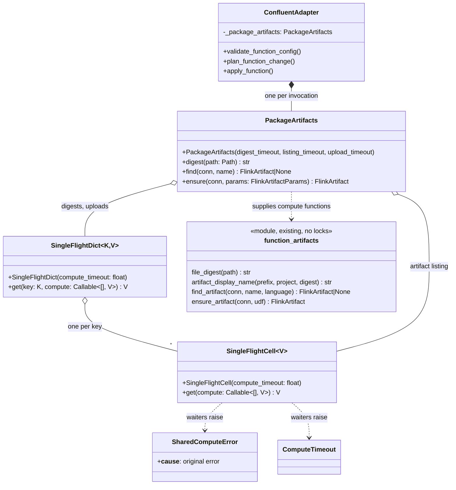
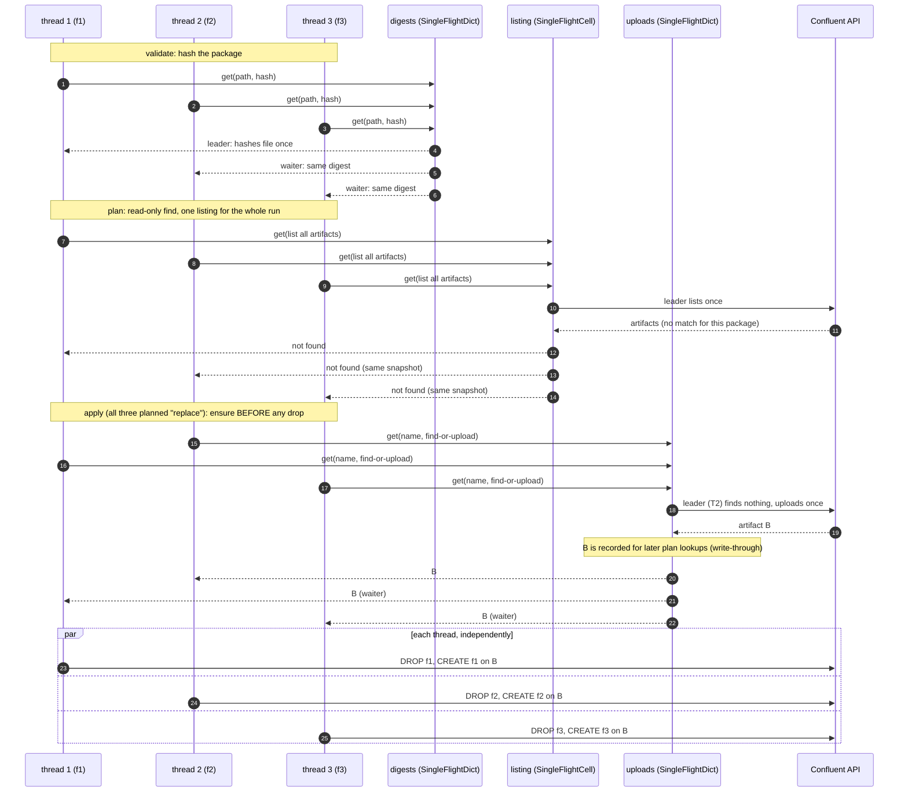
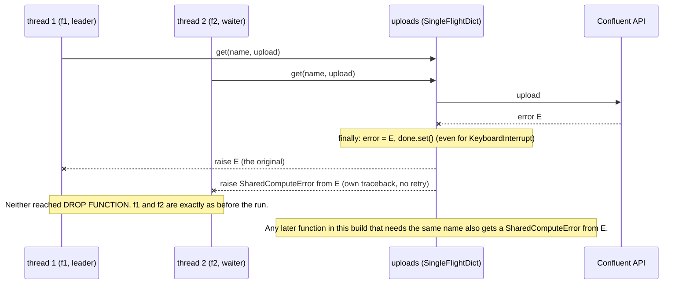
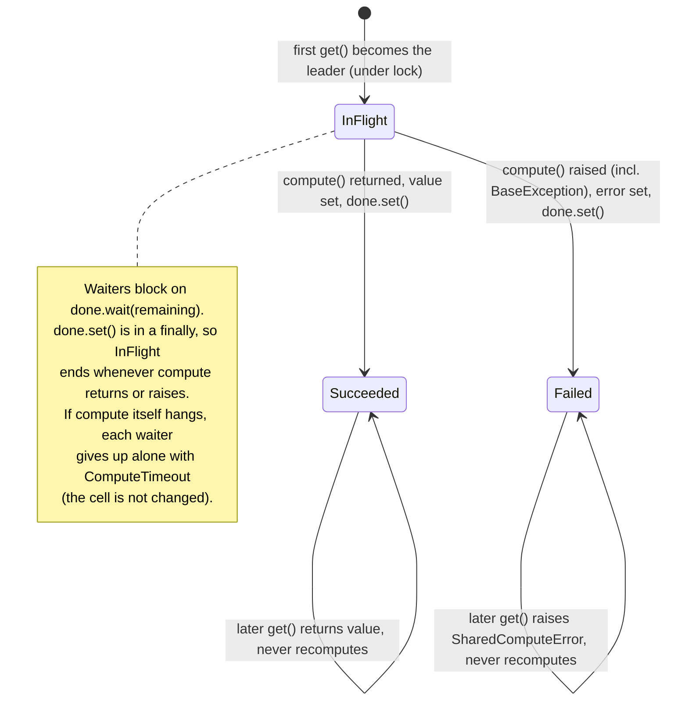
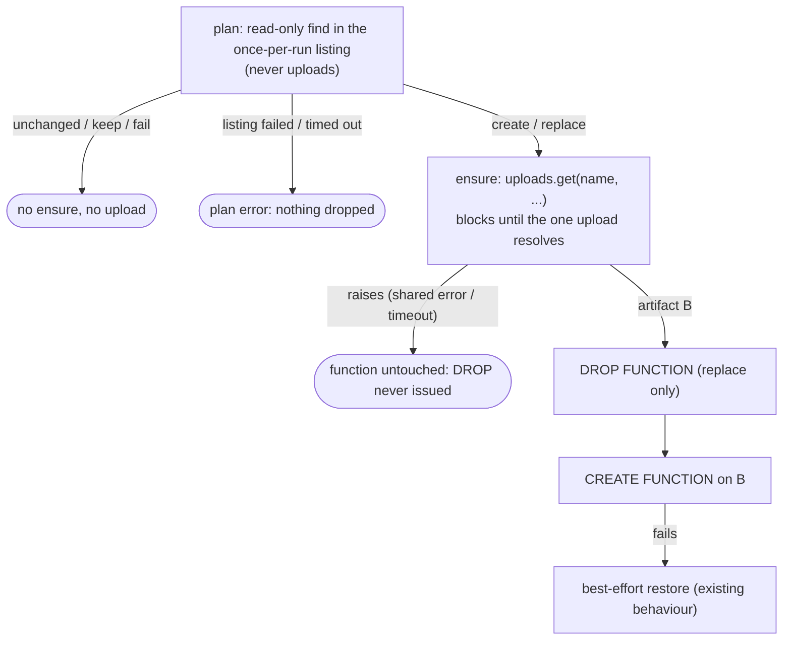

# Design: several functions sharing one UDF artifact

Source design: `design/udfs.md` (on branch `udf-design`) ("Sharing a package between functions").
Status: **all questions answered; decisions recorded in [section 2](#2-decisions). Design and primitives (commit 1) committed; commit 2 (dbt functionality) is staged, see [section 4](#4-implementation-steps-and-commits).**

## Summary

**Problem.** One package can define several functions, but today each function model gets its own artifact, hashes
the file itself, lists artifacts itself, and races other dbt threads to upload.

**Why solve it.** Artifacts are quota-limited and uploads are slow. A package should cost one hash, one artifact
listing and one upload per build, and a failed upload must leave every function that uses it untouched.

**Solution.** Name the artifact after the package alone, and put once-per-key tables (digest, upload) and a
once-per-run artifact listing in front of the slow work. They are built from two small, artifact-agnostic classes,
`SingleFlightCell` (one value) and `SingleFlightDict` (a dict of cells); a third small class, `PackageArtifacts`, owns the
instances. The existing find-or-upload code stays lock-free.

Out of scope here are the design doc's own limitations (cross-process uploads, the drop-to-create crash window,
hash-while-uploading); see [section 1](#1-my-understanding-of-the-ask).

Sections: 1 the ask and how it differs from today's code; 2 decisions (answers to the review questions); 3 the design
(modules, diagrams, invariants); 4 implementation steps and commits.

## 1. My understanding of the ask

A single Java JAR / Python ZIP can define many functions. Today each function model that sets
`artifact_path` gets *its own* artifact, and nothing coordinates dbt's worker threads. We want:

1. **One artifact per package per build**, however many functions point at it (and however many
   threads build them at once).
2. A package is **hashed once** per build, the artifact list is **fetched once** per build, and a package is
   **uploaded at most once** per build.
3. A failure (hash, listing, upload) is **shared**: every function waiting on it fails with that error (each caller with
   its own stack trace), with nothing retried, and **no function is dropped** (the artifact is ensured before any drop).
4. The coordination is **separate, artifact-agnostic modules** with an explicit wait timeout as a backstop; the
   artifact code has no locks.
5. Only *apply* uploads. The plan step is a read-only lookup against the once-per-run listing, so an up-to-date
   function never uploads. Uploads write through to that listing (as dbt's relation cache does for relations it creates).

Out of scope (the doc lists these as limitations, not as part of this feature):
cross-process coordination (limitation 1), the crash window between drop and create (2),
hash-while-uploading (3), changing `cleanup_function_artifacts`.

### What the code does today vs. what the doc says

| Aspect | Today (`main`) | Doc / this plan |
|---|---|---|
| Artifact name | `<prefix><project>-<function>-<digest>` (`function_artifacts.artifact_display_name`, includes the function) | `<prefix><project>-<digest>`, function left out |
| Hashing | `file_digest` on every `validate_function_config` call: once *per function* | once per file per build |
| Artifact listing | `find_artifact` in the plan step lists artifacts *per function* | once per build, filtered locally (**the doc says each plan step looks it up and never remembers "not found"; this is a deliberate change, see decision 7**) |
| Upload | `ensure_artifact`: `find_artifact` then `create`; no in-process coordination, so N threads on one package race, and only the server's `ArtifactAlreadyExistsError` fallback saves us | one upload per build, shared result/error |
| Adapter state | `_CleanupRegistry` is thread-*local*; no shared state | shared once-per-key / once-per-run state on the adapter |

## 2. Decisions

All questions are answered. Decision 7 changes a statement in the design doc; everything else matches it.

| # | Question | Decision |
|---|---|---|
| 1 | Base branch / docs | Based on the implementation; the design doc and forward-looking docs travel on a separate PR track and are **not** touched here. The one doc edit that *is* ours: `MATERIALIZATIONS.md` ("Uploading the artifact") says `<statement prefix><project>-<function>-<digest>`; it changes to `<statement prefix><project>-<digest>`. |
| 2 | Name migration | `function` is unreleased and behind a feature flag: no compat shim, no migration note beyond the feature entry. |
| 3 | Primitive name | `SingleFlightDict`: a dict whose missing entries are filled in, once, by a caller-supplied compute function. Method `get(key, compute)`; the compute function is per call because the upload compute function needs the caller's connection and config, not just the key. Its one-value sibling (decision 7) is `SingleFlightCell`; the dict is just a lock-guarded map of cells. |
| 4 | Failure sharing | A clear stack per caller. The leader raises the original error; each waiter raises its own `SharedComputeError` (`raise ... from original`). The wrapper's message includes the original's type and message so dbt's per-node error line stays useful. |
| 5 | Waiter timeout | Explicit `compute_timeout`, a backstop sized from the upload timeout. See [3.2](#32-singleflightpy). |
| 6 | Language in name | Ignore. |
| 7 | Artifact listing | Fetched **once per run** with a once primitive (`SingleFlightCell`), not a dict. Precedent checked: dbt's relation cache is populated once (`set_relations_cache`) and then kept current by write-through (`cache_added` / `cache_dropped`) under a lock. We follow the pattern (snapshot + write-through for our own uploads) but can't reuse it: it holds relations, not artifacts. **Consequence for the doc:** it says the plan lookup never remembers "not found"; now a snapshot can hold a stale miss. See [3.9](#39-the-snapshot-and-stale-misses) for why that is safe. The doc's wording needs a follow-up on its own track. |
| 8 | Live test | Yes: one functional test, two function models over one package (same class), asserting one artifact and the same id on both. |
| 9 | Commits | Self-contained, well-named commits, each passing tests and lint; they can ship as stacked PRs: design <- primitives <- dbt functionality. See [section 4](#4-implementation-steps-and-commits). |
| 10 | Adapter lifetime | No known setups reuse an adapter across invocations. Tables are created in `ConfluentAdapter.__init__`; a unit test shows a new adapter instance starts empty. |

Timeout sizing facts (from the driver, so the numbers aren't guessed): an artifact upload has a 300 s per-request
timeout (`upload_timeout`, default 300; httpx applies it per network phase, not as a total), 3 connect retries, and
`create` also makes a presign call and a register call at the driver's HTTP timeout (60 s in our connection).
dbt doesn't pass `upload_timeout` today, so the 300 is an implicit driver default. We pass it explicitly from a named
constant so the backstop can't drift from it.

## 3. Design

### 3.1 Module map

Four small units. Only the first two know about concurrency and timeouts; only the last two know about artifacts.



### 3.2 `singleflight.py`

New, `dbt/adapters/confluent/singleflight.py`, about 70 lines, no dbt/confluent imports.

```python
K = TypeVar("K", bound=Hashable)
V = TypeVar("V")

class SharedComputeError(Exception):
    """Raised to a waiter when the caller that computed its value failed. `__cause__` is the original error."""

class ComputeTimeout(TimeoutError):
    """Raised to a waiter that gave up waiting for the value to be computed."""

class SingleFlightCell(Generic[V]):
    """One value, filled in once by whichever caller asks first.

    `get(compute)`: the first caller (the leader) runs `compute()` on its own thread; later callers block until
    it finishes and receive the same value. The outcome is remembered for the life of the object, a failure
    included, so nothing is retried. The leader sees the original error; each waiter gets its own
    `SharedComputeError` chained to it, so every caller has its own traceback. A waiter stops waiting
    `compute_timeout` seconds after computation began and raises `ComputeTimeout` (the leader keeps running,
    and the value is still recorded if it later finishes). `compute` must not call `get` on the same cell.
    """

    def __init__(self, compute_timeout: float) -> None: ...
    def get(self, compute: Callable[[], V]) -> V: ...

class SingleFlightDict(Generic[K, V]):
    """A dict of `SingleFlightCell`s: `get(key, compute)` is `cell_for(key).get(compute)`."""

    def __init__(self, compute_timeout: float) -> None: ...
    def get(self, key: K, compute: Callable[[], V]) -> V: ...
```

Internals (the whole safety argument fits here):

- **`SingleFlightCell`** holds a `threading.Lock` only to decide who is the leader (first `get` flips `_started` and records
  `started_at = time.monotonic()`), never while `compute` runs. State: `done: threading.Event`, `value`, `error`.
  - Leader: `try: value = compute()` / `except BaseException as e: error = e; raise` / `finally: done.set()`.
    `BaseException` and `finally` make "the uploader always fills in its result, even if interrupted" true (a
    `KeyboardInterrupt` on the leader thread still wakes the waiters).
  - Waiter: `done.wait(remaining)` where `remaining = started_at + compute_timeout - now`. On timeout, raise
    `ComputeTimeout` (the waiter's own; **not** recorded in the cell). Otherwise `raise SharedComputeError(...) from error`, or return `value`.
  - No eviction, no `forget`.
- **`SingleFlightDict`** holds a `threading.Lock` only to look up / insert the cell (`setdefault`), never while computing, so different
  keys proceed in parallel. All waiting logic is in the cell.

**Timeouts.** The backstop is passed in, never defaulted inside the primitives, so each value is visible where it is used.
In `function_artifacts.py`: `UPLOAD_TIMEOUT_SECS = 300` (passed explicitly to the driver's `create(upload_timeout=...)`,
replacing today's implicit default). In `PackageArtifacts`: upload table `2 * UPLOAD_TIMEOUT_SECS` (find + presign + upload + register, with
connect retries, is not a single 300 s phase, so 2x is a backstop, not a bound); digest table 300 (a local hash; generous
on purpose); listing 300 (paginated at a 60 s HTTP timeout). All are constructor arguments, so tests use tiny values.

Stdlib check: `functools.cache`/`lru_cache` don't stop two threads computing the same key concurrently and don't share
failures; `concurrent.futures.Future` could model a cell, but Future + our timeout/error rules is the same code with more surface. Own module it is.

### 3.3 `package_artifacts.py`

New, `dbt/adapters/confluent/package_artifacts.py`, about 45 lines.

```python
class PackageArtifacts:
    """What a build knows about package artifacts, shared by all its threads. One instance per dbt invocation."""

    def __init__(self, digest_timeout: float = ..., listing_timeout: float = ..., upload_timeout: float = ...) -> None: ...

    def digest(self, path: Path) -> str:
        """Digest of the package file's content, computed once per real path."""
        return self._digests.get(path.resolve(), lambda: function_artifacts.file_digest(path))

    def find(self, conn: Connection, name: str) -> FlinkArtifact | None:
        """Read-only lookup for the plan step: this build's once-fetched listing, plus anything this build uploaded."""
        ...

    def ensure(self, conn: Connection, params: FlinkArtifactParams) -> FlinkArtifact:
        """The artifact for this package, found or uploaded once per package content; recorded for `find` on success."""
        return self._uploads.get(params.digest, lambda: self._ensure_and_record(conn, params))
```

`find` lists **all** artifacts once (no runtime-language filter, as `cleanup_function_artifacts` already does) and matches by
`display_name` alone: the server requires an artifact name to be unique per environment whatever its language. Artifacts uploaded this build are held
in a small `dict[str, FlinkArtifact]` (written once per name, by the upload leader) and checked first. No locks in this class.

### 3.4 Changes to existing code

| File | Change |
|---|---|
| `function_artifacts.py` | `artifact_display_name(prefix, project, digest)`: drop the `function` parameter. New `UPLOAD_TIMEOUT_SECS`; `ensure_artifact` passes `upload_timeout=UPLOAD_TIMEOUT_SECS` to `create` (otherwise unchanged, still handles cross-process `ArtifactAlreadyExistsError` with a fresh lookup). Update module docstring. |
| `impl.py` `__init__` | `self._package_artifacts = PackageArtifacts()` (shared across threads, with a comment saying why it differs from `_CleanupRegistry`). |
| `impl.py` `validate_function_config` | `self._package_artifacts.digest(Path(udf["artifact_path"]))`; name no longer takes `relation.identifier`. |
| `impl.py` `plan_function_change` | `self._package_artifacts.find(conn, name)` instead of `function_artifacts.find_artifact`. |
| `impl.py` `apply_function` | `self._package_artifacts.ensure(conn, FlinkArtifactParams.from_udf(udf))` instead of `function_artifacts.ensure_artifact(conn, udf)`. |
| `function.sql` | unchanged. |
| Docs | Amend `changes/180.feature.md` (unreleased, so no migration note). `MATERIALIZATIONS.md` "Uploading the artifact": new name `<statement prefix><project>-<digest>`, plus one sentence that functions over the same package share one artifact. Dbt level only, no driver internals. `design/udfs.md` is not touched (separate PR track); this document is the only file added under `design/`. |

New parameters annotated per repo convention. Tests follow the shared-constant/visible-trigger conventions (the package
content and the number of functions/threads are named constants used in both setup and assertions).

### 3.5 Concurrency: how one package is handled by many threads

Three function models, `threads >= 3`, one package. T2 reaches `ensure` first.



### 3.6 Failure: shared, and no function is touched



The same holds for a failed listing in the plan step: every function's plan fails before anything is dropped.

### 3.7 Cell life cycle (why a waiter can never see a half-result)



### 3.8 Ordering guarantee per function (safety of the shared path)



### 3.9 The snapshot and stale misses

The listing is read once, so a plan lookup can miss an artifact that appeared after the snapshot:

- **Uploaded by this build:** closed by write-through. The upload leader records its artifact before releasing waiters,
  and `find` checks that record first. The one remaining window is a function that planned before the upload finished;
  it sees "not found" and plans a replace. That is correct: it cannot be live on an artifact that didn't exist yet.
- **Uploaded by another process after the snapshot** (the doc's limitation 1): a function already on that artifact plans a
  replace it didn't need. `ensure` then finds the artifact with a fresh lookup, so nothing is uploaded; the function is dropped and
  re-created on the same artifact, which is churn but correct. With `on_configuration_change: fail`, it errors spuriously. Same
  workaround as limitation 1 (don't run two builds that change the same package at once).
- **Stale in the "unchanged" direction** needs an artifact that existed at the snapshot to disappear. dbt never deletes artifacts during
  a run, so only a concurrent manual cleanup could; that's already unsupported (see Cleanup).

### 3.10 Invariants and how each is enforced and tested

| Invariant | Enforced by | Test |
|---|---|---|
| `compute` runs once, even with N simultaneous callers | leader chosen under lock; leader/waiter split | N threads released by a `Barrier` into `cell.get(counting_fn)`; assert count == 1 and all results identical |
| Different dict keys don't block each other | lock never held across `compute` | key A's `compute` blocks on an `Event`; key B completes meanwhile |
| A failure is shared, not retried | `error` replayed; cell never reset | `compute` raises; the leader sees the original, every waiter a `SharedComputeError` whose `__cause__` is it; count == 1; a later call raises again without recomputing |
| Every caller has its own traceback | waiters raise a fresh wrapper, never the shared object | two waiters' `__traceback__` objects differ and neither contains the other thread's frames |
| Waiters can't hang, even on `KeyboardInterrupt`/`SystemExit` in the leader | `except BaseException` + `finally: done.set()` | `compute` raises `KeyboardInterrupt` (leader thread); waiter returns promptly (join with timeout) |
| A hung `compute` can't hang waiters forever | `done.wait(remaining)` against `started_at + compute_timeout` | `compute` blocks on an `Event`; waiter with a tiny timeout gets `ComputeTimeout`; the cell is unchanged, and releasing the leader later lets a new `get` return the value |
| One file hashed once; copied packages share an upload | digests keyed by resolved path; uploads keyed by `ArtifactDigest` (a `NewType` only `file_digest` makes) | `PackageArtifacts` with fake driver: 2 paths, identical bytes, N threads → 1 `create`, 1 hash per path; `create` receives `upload_timeout=UPLOAD_TIMEOUT_SECS` |
| Artifacts are listed once per run, whatever the number of functions | listing is a `SingleFlightCell` | N threads call `find` → 1 `list` call; a failing `list` fails all N, with 1 call |
| This build's own uploads are visible to later plans | `ensure` records before returning | `ensure` then `find` for the same name returns the uploaded artifact with no second `list` |
| Nothing dropped before the shared artifact resolves | `apply_function` order: `ensure` → drop → create (unchanged) | existing ordering tests plus: shared upload failure → no `drop function` event for any thread |
| Plan never uploads | plan path calls `find`, never `ensure` | unchanged function with `artifact_path` → zero `create` calls |
| Tables are per invocation | created in `ConfluentAdapter.__init__` | new adapter instance → empty tables → re-hashes a changed file, re-lists |
| Live: two functions, one package → one artifact | all of the above | functional test (decision 8) lists artifacts by project marker, asserts one new artifact and the same id on both functions |

### 3.11 Deadlock check

- A leader's `compute` uses only its own thread's connection and never waits on another waiter or on `get` of another cell.
- `digest` completes (during `validate`) and the listing (during `plan`) before `ensure` runs, so the tables never nest.
- A waiter holds a dbt worker thread while blocked, for at most `compute_timeout`. With `threads: 1` there are no concurrent waiters;
  with more threads the leader is already running, so progress doesn't depend on a free thread.

## 4. Implementation steps and commits

One branch, a series of self-contained commits, each passing unit tests and lint on its own. Per standing preference I stage each
step and hold the commit (and any push, which uses `git push-external`) until you say so, using these boundaries and names:

0. **`Design: sharing one UDF artifact between several functions`** (done): this document, plus its
   `+multi-function-artifacts-design.trivial.md` changelog fragment. It may later be cleaned up into a standalone design doc
   without the review discussion.
1. **`Add SingleFlightCell and SingleFlightDict`**: `singleflight.py` + `tests/unit/test_singleflight.py` (invariants rows 1-6). Nothing else touched.
2. **`Hash, list and upload function packages once per build`**: `package_artifacts.py` + `UPLOAD_TIMEOUT_SECS`, wired into
   `impl.py` (`__init__`, `validate_function_config`, `plan_function_change`, `apply_function`). The artifact name drops the
   function in this commit too, since the upload table is keyed by `ArtifactDigest` and sharing needs one name per package
   (functions over one package would otherwise plan a replace on every run). `ensure_artifact` takes a `FlinkArtifactParams`,
   not the config dict. Unit tests for the `PackageArtifacts` rows and ordering/per-invocation rows; the live functional test
   (two models, one package, `threads: 2`); `MATERIALIZATIONS.md`, `changes/180.feature.md`.

**PR stacking.** The commits can ship as a stack of PRs, each based on the previous: design (commit 0) <- primitives (commit 1)
<- dbt functionality (commit 2). Every PR needs a `changes/` fragment (CONTRIBUTING; CI blocks without one): the design
one is committed; the primitives PR needs a `+singleflight.trivial.md`; the functionality PR amends `changes/180.feature.md`.
Retarget each PR to `main` as its parent merges.

Verify with `UV_NO_CONFIG=1 uv run ...` (unit tests, lint); live tests run with credentials once step 2 is staged.

Estimated size: ~150 lines primary code across commits 1-2; ~300 lines of tests; well within the PR limits.
