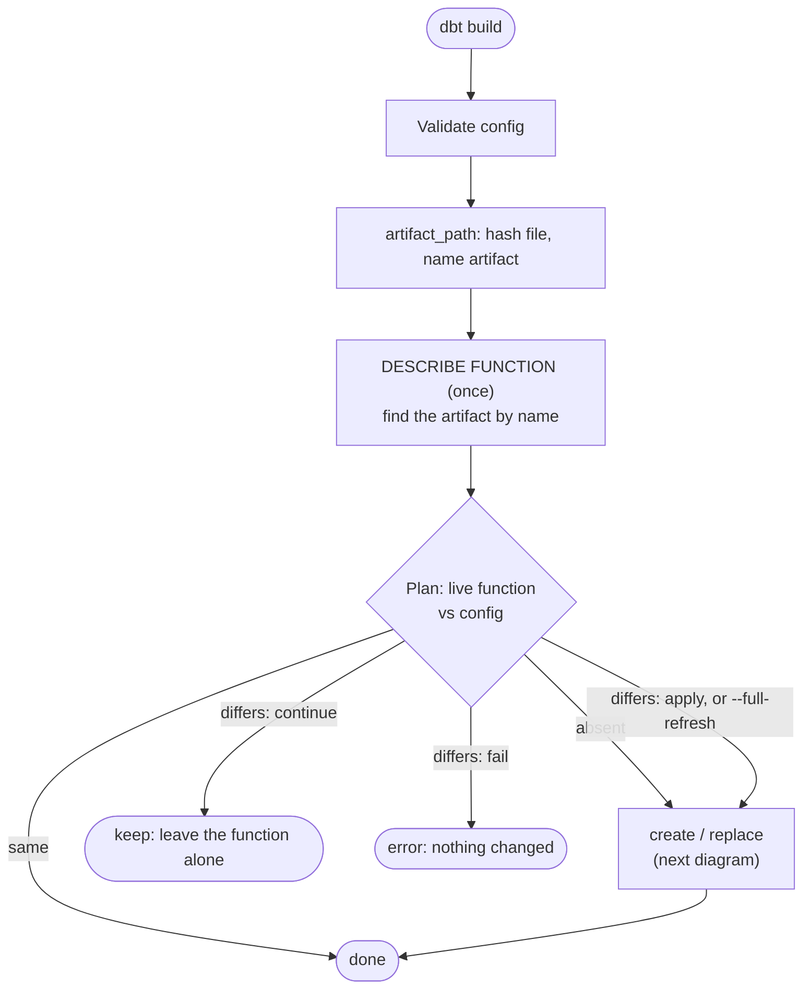
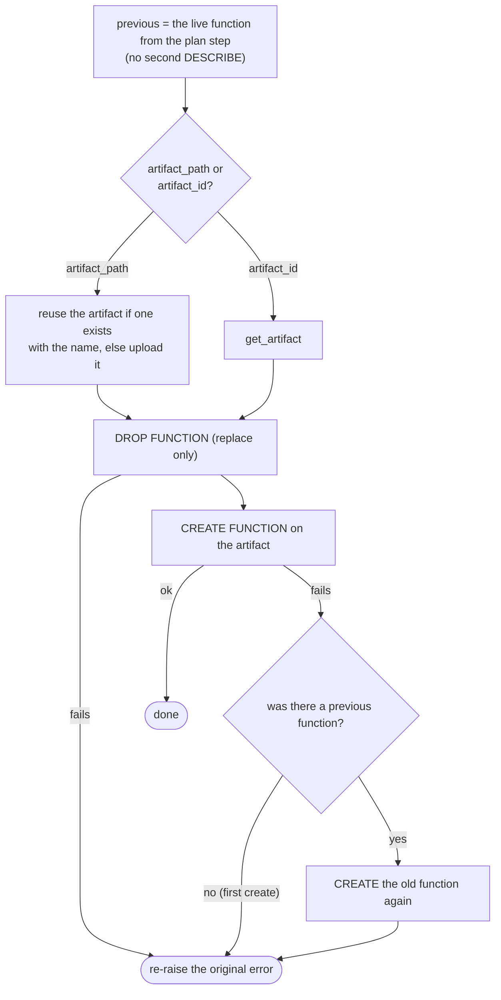

# How the `function` materialization works

For maintainers and reviewers. How to *use* it is in [MATERIALIZATIONS.md](../MATERIALIZATIONS.md#function).

## Summary

### Problem

Flink functions and their packages (artifacts) are immutable, so changing a function means
uploading a new artifact, dropping the function and re-creating it. If that fails part way, or dbt dies
in the middle, the function is gone and new statements can't use it. Running statements are not affected
by the function being dropped; they are only at risk if the artifact they are bound to is deleted.

**Why solve it.** `dbt build` should be able to manage a function from a package on disk without risking
the function it replaces or negatively impacting existing statements.

### Solution

dbt names each artifact after its package's content hash, confirms the new artifact before dropping anything, and
re-creates the old function if the new one can't be created. That rollback happens in the running process only.

This solution comes with some identified [limitations](#limitations).

The rest of this document adds detail, in order: the constraints, one run in words and a diagram, the artifact
description, the guarantees, cleanup, what each crash leaves behind, the limitations, and the platform changes that
would simplify it. Terms are defined in [Terms](#terms) at the end.

### Core risks and mitigations

| Risk | Mitigation |
|---|---|
| Deleting an artifact can break existing statements that are bound to it. Dropping a *function* does not: running statements keep their artifact. | dbt never drops an artifact itself. It provides a [cleanup operation](#cleanup) to help the user delete the unused ones. |
| Re-creating a function is two steps (drop, create), and a failure in between can break the creation of *new* statements that use it. | The new artifact is confirmed before the drop, and a failed create re-creates the old function within the run. A run that dies between the drop and the create is not covered; see [limitation 2](#limitations). |
| Every upload creates a new artifact, and an org has a hard limit on how many it can have in one scope (cloud and region). Uploading on every run would exhaust it. | The artifact's name carries a client-computed checksum of the package. An unchanged package finds its existing artifact by name and is not uploaded again; only a changed package adds one. Functions that share a package share its artifact, and a build uploads it at most once. See [Sharing a package between functions](#sharing-a-package-between-functions). |

## Detailed Design

### How UDFs are built, and why it is tricky

A [Flink UDF](https://docs.confluent.io/cloud/current/flink/how-to-guides/create-udf.html) is a Java
JAR or Python package that Confluent stores as an **artifact**. A function is created *from* an
artifact: `CREATE FUNCTION ... USING JAR 'confluent-artifact://<artifact id>'`. The
`function` materialization manages both. A model points at a package on disk:

```sql
-- functions/is_smaller.sql
{{ config(
    language='python',
    artifact_path='udfs/example_udf.zip',   -- or artifact_id='cfa-xxxxxx' for one uploaded already
    class='example_udf.tshirt_sizing.is_smaller',
    on_configuration_change='apply',        -- or 'continue' / 'fail'; what to do if the function differs
) }}
```

Two Confluent rules make changing a function awkward:

- **Functions are immutable.** There is no `ALTER` or `CREATE OR REPLACE`: to change one you drop and
  re-create it, so a failure part way can leave you with no function.
- **Artifacts are immutable.** A changed package is a *new* artifact. Statements already running
  stay bound to the artifact they were compiled against.

So a replacement is several steps (upload, drop, create) and dbt has to be able to undo it if one fails.

### High-level Function Materialization Algorithm

At a high level, the function materialization goes through the following process (the next section provides additional details on the update flow):

1. Validate the config: exactly one of `artifact_path` / `artifact_id`, the file exists, and its extension (`.jar`/`.zip`) matches the language.
2. For `artifact_path`, hash the file (once per build, however many functions use it) and work out the [artifact name](#terms).
3. `DESCRIBE FUNCTION` once, to get the live function (or learn it doesn't exist), and look the artifact up by name.
4. Plan by comparing the live function (class, language, artifact, connections) with the config:
   absent → create; differs → replace, or keep/fail per `on_configuration_change`; same → nothing to change.
5. Create or replace (below).



### Create / replace



Any failure in the artifact step (the upload, or `get_artifact`) or in the drop aborts the run with the function still in place.

The previous function is held in memory only. If the dbt process dies between the drop and the create, or the
rollback itself fails, nothing remembers the old function.

### Sharing a package between functions

A package can define several functions, and dbt builds models on parallel threads, so several functions can ask for
the same package at the same moment. The artifact name leaves the function out so they share one artifact, and two
[single-flight](#terms) tables make sure that each piece of work is done once per build:

| Table | Key | Value | Why this key |
|---|---|---|---|
| Digest | the package file's real path | the file's digest | One file is hashed once, however many functions point at it. |
| Artifact | the [artifact name](#terms) | the artifact (reused or uploaded) | Different paths with identical content (a copied package) get the same name, so they still upload once. |

The first thread to ask for a key does the work, and every other thread asking for it waits and gets the same
result. A failure is shared the same way: every waiting function fails with the same error, and nothing retries within
the build. The uploader always fills in its result, even if it is interrupted, so a waiter can't hang.

Only an apply goes through the artifact table. The lookup in the plan step is a read-only find, so a function that is
already up to date never uploads, and a "not found" is never remembered while another thread is about to upload.
Both tables live for one invocation of dbt and start empty on the next, so a file that changed between runs is hashed
again.

The single-flight logic is its own module, with no knowledge of artifacts: it takes a key and a function to compute the
value. The upload code supplies the functions (hash this file, find or upload this artifact) and has no locking in it.

## The artifact description

dbt writes a small marker into the `description` of each artifact it uploads (`artifact_path` only):

```json
{"managed_by": "dbt-confluent", "project": "my_project"}
```

The [marker](#terms) lets [cleanup](#cleanup) tell an artifact dbt uploaded, and for which dbt project, from one it
didn't. It is written once, at upload, and never changed. An artifact named by `artifact_id` was not uploaded by dbt, so
it has no marker.

## Guarantees

- **Nothing is dropped until the new artifact is confirmed**: uploaded, or `get_artifact` succeeded. A bad artifact fails with the function untouched.
- **A failed create after the drop is rolled back.** The old function is re-created from what was described before the drop, with no second `DESCRIBE`.
- **Rollback is best-effort**; the original error is always re-raised. It covers a failure within the run only: nothing survives a crash or a retry.
- **A package is hashed once and uploaded at most once per build**, however many functions use it and on however many threads. Every function sees the same result or the same error.
- **A replace never deletes the old artifact.** See below.

## Cleanup

dbt never deletes an artifact during a run. Statements (such as a `streaming_table` that calls the
function) stay bound to the artifact they were compiled against; if that artifact is deleted, stopping and
resuming one fails with "plugin not found". dbt can't tell which statements those are, so an artifact
that no *function* uses is not necessarily unused.

`dbt run-operation cleanup_function_artifacts` is the manual way to remove old ones:

1. List every artifact in the environment, keeping those whose marker names **this** dbt project. (Artifacts of other projects, or uploaded by hand, are never touched.)
2. Then read which artifacts the environment's functions use (`INFORMATION_SCHEMA.ROUTINES`, the catalog of functions). Reading functions *after* the artifacts means a function created in between can't leave its artifact looking unused.
3. The [orphans](#terms) (no function uses them) are listed, and the command to delete them is printed.
4. Nothing is deleted by default. `delete: true` deletes the orphans, on your word that the dependent statements were recreated. Every delete is tried and failures are reported at the end.

A replacement uploads its artifact before it creates the function, so for a moment the new artifact looks like an
orphan. Don't run cleanup with `delete: true` while a `dbt build` that manages functions is running.

## Crash points

State if the run dies after each step (function `f` on old artifact **A**, new package → **B**):

| Dies after | `f` | Artifacts | Next run |
|---|---|---|---|
| Upload B | on A | A, B | Reuses B and replaces `f` |
| Drop `f` | absent | A, B | Creates `f` on B from the config. The old `f` on A is not restored. |
| Create `f` on B | on B | A, B | Plan = same → nothing to do (A stays until cleaned up) |

## Limitations

1. **Concurrent dbt runs can still upload the same package twice**

   Sharing a package is coordinated inside one dbt invocation only. Two dbt processes (for example two CI jobs) that
   change the same package at once can both upload it. Creating an artifact is two calls: the bytes go to object
   storage, then the create call registers them under the name. Names are unique per cloud, region and environment,
   so the second run's create call is refused with "already exists", after its bytes were already uploaded. That run
   looks the artifact up and reuses it. Correctness is not affected, but the upload work was done twice. The second
   copy of the bytes is never attached to an artifact, and dbt has no way to remove it. The same is true of any
   create failure after a successful upload: the run fails before anything is dropped, and the next run uploads again
   from scratch.

   **Workaround.** Don't run two builds that change the same package at once.

2. **A run that dies between the drop and the create leaves no function**

   Rollback happens in the running process, and the old function is held in memory. If the dbt process dies (or the
   user cancels the run) between the drop and the create, nothing remembers the old function, and the next run only
   sees that the function is absent. The same goes for a retry after a failed rollback. Creating a function is
   slow, so the window is not short. This applies to `artifact_path` and `artifact_id` alike.

   **Workaround.** Re-run the build to create the function from the config, or restore the old one by hand. To
   avoid the window where consumers can't be updated together with the function, set `on_configuration_change` to
   `fail` or `continue`.

   **Possible follow-up.** Persist the old function before dropping it, so a later run can restore it. See
   [Alternatives](#alternatives).

3. **A package that changes during a build can be uploaded under the wrong name**

   A package is read twice: once to hash it (which fixes the [artifact name](#terms)) and once to upload it. If the
   file changes in between, the artifact's content no longer matches the digest in its name, and a later run
   with the real content would reuse it. This needs the package to be rewritten while `dbt build` is running, which
   is rare, but nothing detects it today.

   **Planned mitigation.** Before the upload is registered, the artifact's content must be checked against its name.
   Options considered:

   - **Hash while uploading** (preferred): hash the bytes as the upload reads them, and create the artifact only if
     the digest matches the name. It is exact and needs no copy and no extra read.
   - **Check the file's size and modified time** before and after the upload. It is cheaper, but it can miss a change
     that preserves both.
   - **Upload from a snapshot** (a temp copy, or the bytes in memory). It prevents the change, but packages can be
     large, so a copy is slow and holding it in memory is costly.

## Platform asks

Most of the machinery above exists to work around gaps in the platform. These are the changes to Confluent
Cloud's APIs and SQL that would let us remove it. None is required for the current design.

1. **SQL support for replacing a function in one operation**

   `CREATE OR REPLACE FUNCTION` (or `ALTER FUNCTION ... USING`), applied atomically, so there is no window
   in which the function is absent. This is already planned platform-side.

   *Simplifies:* it removes the drop-then-create gap that the in-run rollback and the
   [crash table](#crash-points) exist for, and it closes [limitation 2](#limitations).

2. **A strong guard on deleting artifacts that statements still use**

   Today deleting an artifact succeeds even when running or stopped statements are bound to it, and those
   statements later fail to resume with "plugin not found". Deleting should be refused (or need an explicit
   force) while any statement references the artifact. Listing which statements reference an artifact would
   also help.

   *Simplifies:* dbt could delete superseded artifacts itself instead of never deleting any. The
   "an artifact that no *function* uses is not necessarily unused" caveat, the `delete: true` "on your word"
   step and the [orphan](#terms) bookkeeping in [Cleanup](#cleanup) would mostly go away, and the artifact
   quota risk would be handled without a manual operation.

3. **A content checksum on artifacts (low priority/impact)**

   Artifact content never passes through Confluent (it is uploaded to object storage by the client), so the
   platform cannot hash it today. The ask is for the API to either expose a checksum that the storage provider
   reports, or accept a client-computed checksum at upload and record it. The artifact could then be found by
   content rather than by a name that encodes the hash.

   *Simplifies:* the [artifact name](#terms) would no longer have to carry the digest, and an unchanged package
   could be found by its content.

## Alternatives

### Persist the old function so a crash can be recovered

Write a record of the old function (its class, language, artifact and connections) to the new artifact's
`description` before dropping, and clear it once the new function exists. A later run that finds the record could
restore the old function or finish the change, even if the process died in between.

Not chosen for now, because it adds a lot of machinery: reconciling a record that has gone stale, handling an
artifact that is stranded with a record when the package changes again, and extra states in cleanup and the crash
table. The in-run rollback already handles an *invalid* new function, which is caught while the run is alive. The
record would only help the run that never gets to roll back, so the cost is accepted as
[limitation 2](#limitations) until it proves to matter.

### Create only, with changes left to the user

Create a function if it is absent and never replace one. Updating is a manual process: drop the function
yourself and re-run.

Not the default, because it makes iterating on a function (the main reason to manage one from dbt) a manual
chore. It is available to anyone who prefers it, through `on_configuration_change`, which defaults to
`apply`:

- `continue`: create the function if it is absent. If it exists but differs from the config, leave it in place
  and log a warning naming the differences. Nothing is uploaded or dropped.
- `fail`: create it if absent. If it differs, stop with an error and change nothing.

Both leave an existing function alone, so neither can hit the drop-then-create gap. `--full-refresh`
still replaces an existing function whatever the setting, since it is an explicit request to rebuild.

## Terms

| Term | Meaning |
|---|---|
| **Artifact name** | `<statement_name_prefix><project>-<digest>`. The prefix is the profile's `statement_name_prefix`; the digest is the first 16 hex characters of the package's SHA-256. Same package, same name, whichever function uses it. |
| **Single-flight** | A table where the first caller for a key does the work and later callers wait for, and share, its result or error. |
| **Marker** | `managed_by` (and `project`) in an artifact's description. It says dbt uploaded the artifact, for which dbt project. |
| **Orphan** | An artifact of this project that no function uses. See [Cleanup](#cleanup). |
