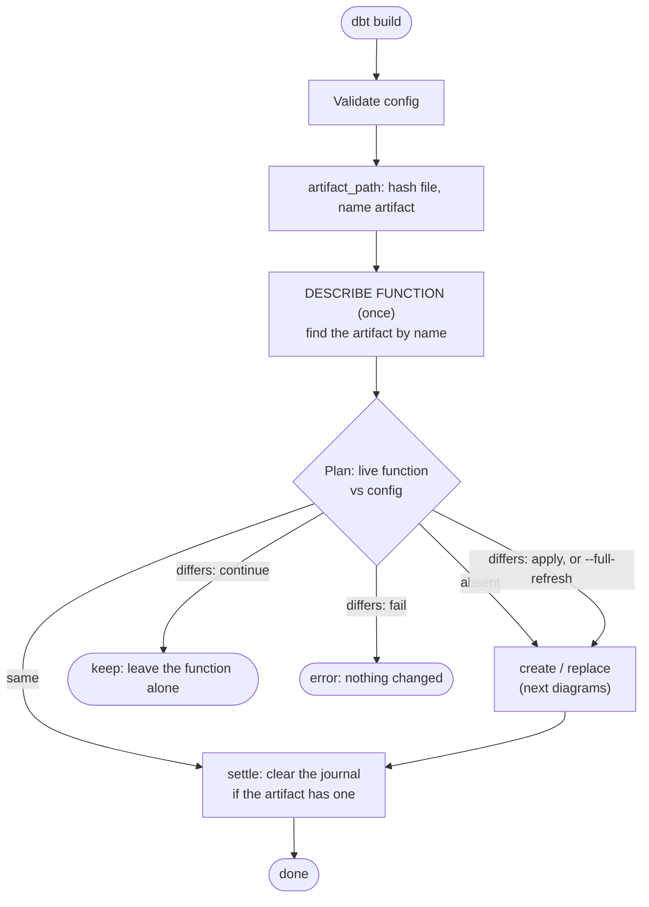
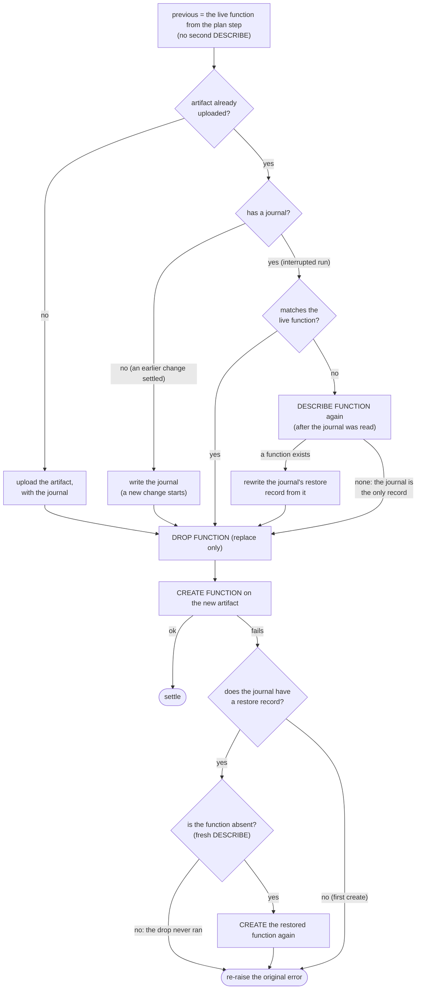
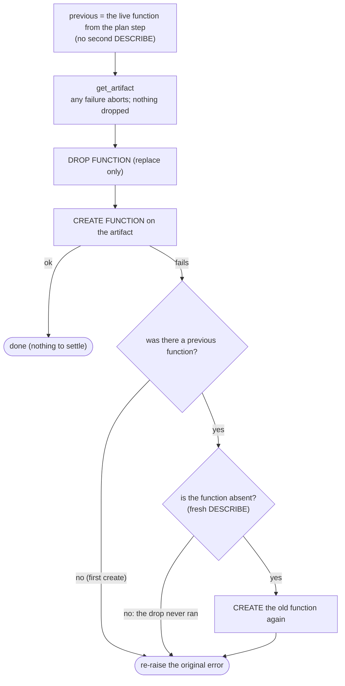

# How the `function` materialization works

For maintainers and reviewers. How to *use* it is in [MATERIALIZATIONS.md](../MATERIALIZATIONS.md#function).

## Summary

### Problem

Flink functions and their packages (artifacts) are immutable, so changing a function means
uploading a new artifact, dropping the function and re-creating it. If that fails part way, or dbt dies
in the middle, the function is gone and new statements can't use it. Running statements are not affected
by the function being dropped; they are only at risk if the artifact they are bound to is deleted.

**Why solve it.** `dbt build` should be able to manage a function from a package on disk without risking
the function it replaces or negatively impacting existing statements.

### Solution

dbt names each artifact after its package's content hash and records the old function in a
[*journal*](#terms) on the new artifact before dropping anything, so a failed or interrupted change is undone, or
finished on the next run.

This solution comes with some identified [limitations](#limitations).

The rest of this document adds detail, in order: the constraints, one run in words and diagrams, the journal,
the guarantees, cleanup, what each crash leaves behind, the limitations, and the platform changes that would simplify it. Terms are defined in [Terms](#terms) at the end.

### Core risks and mitigations

| Risk | Mitigation |
|---|---|
| Deleting an artifact can break existing statements that are bound to it. Dropping a *function* does not: running statements keep their artifact. | dbt never drops an artifact itself. It provides a [cleanup operation](#cleanup) to help the user delete the unused ones. |
| Re-creating a function is two steps (drop, create), and a failure in between can break the creation of *new* statements that use it. | A rollback journal, written before the drop and settled on every `dbt build`. See [The journal](#the-journal). |
| Every upload creates a new artifact, and an org has a hard limit on how many it can have in one scope (cloud and region). Uploading on every run would exhaust it. | The artifact's name carries a client-computed checksum of the package. An unchanged package finds its existing artifact by name and is not uploaded again; only a changed package adds one. |

## Detailed Design

### How UDFs are built, and why it is tricky

A [Flink UDF](https://docs.confluent.io/cloud/current/flink/how-to-guides/create-udf.html) is a Java
JAR or Python package that Confluent stores as an **artifact**. A function is created *from* an
artifact: `CREATE FUNCTION ... USING JAR 'confluent-artifact://<artifact id>'`. The
`function` materialization manages both. A model points at a package on disk:

```sql
-- functions/is_smaller.sql
{{ config(
    language='python',
    artifact_path='udfs/example_udf.zip',   -- or artifact_id='cfa-xxxxxx' for one uploaded already
    class='example_udf.tshirt_sizing.is_smaller',
    on_configuration_change='apply',        -- or 'continue' / 'fail'; what to do if the function differs
) }}
```

Two Confluent rules make changing a function awkward:

- **Functions are immutable.** There is no `ALTER` or `CREATE OR REPLACE`: to change one you drop and
  re-create it, so a failure part way can leave you with no function.
- **Artifacts are immutable.** A changed package is a *new* artifact. Statements already running
  stay bound to the artifact they were compiled against.

So a replacement is several steps (upload, drop, create) and dbt has to be able to undo or finish
it if one fails, even if the dbt process dies in the middle.

### High-level Function Materialization Algorithm

At a high level, the function materialization going through the following process (the next section provides additional details on the update flow):

1. Validate the config: exactly one of `artifact_path` / `artifact_id`, the file exists, and its extension (`.jar`/`.zip`) matches the language.
2. For `artifact_path`, hash the file and work out the [artifact name](#terms).
3. `DESCRIBE FUNCTION` once, to get the live function (or learn it doesn't exist), and look the artifact up by name.
4. Plan by comparing the live function (class, language, artifact, connections) with the config:
   absent → create; differs → replace, or keep/fail per `on_configuration_change`; same → nothing to change.
5. Create or replace (below), then [settle](#terms).



### Create / replace with `artifact_path`



The journal stays on the new artifact after a failure, so the next run knows a change is unfinished.

A journal that is kept may be stale: other runs can have replaced the function since. The run described the
function *before* it read the artifact, so on a mismatch it describes it once more. That second
`DESCRIBE` comes after the journal was read, so a function that differs from the journal's record has
certainly superseded it, and the record is rewritten from the function. If there is no function, the
journal is the only record of the original and is kept. A journal that already matches costs no extra `DESCRIBE`.

### Create / replace with `artifact_id`

The artifact was uploaded outside dbt, so dbt writes no journal to it. Rollback still works within the run,
but nothing records an unfinished change.



If the dbt process dies between the drop and the create, nothing remembers the old function. The same goes for a
retry after a failed rollback, where there is no longer a previous function to restore.

## The journal

It is JSON in the *new* artifact's `description`:

```json
{
  "managed_by": "dbt-confluent",
  "project": "my_project",
  "journal": {
    "restore": {
      "class_name": "…",
      "language": "…",
      "artifact_id": "cfa-old",
      "connections": [
        "`env`.`db`.`conn`"
      ]
    }
  }
}

```

The whole value is the description. `managed_by` and `project` are the [marker](#terms). The `journal` key is the
journal, and it currently holds only the [restore record](#terms), `restore`: the function that was live before the change
(`artifact_id` is the artifact it ran on).

When a change completes, the `journal` key is removed and the marker stays:
`{"managed_by":"dbt-confluent","project":"my_project"}`. That is what lets cleanup still recognise the artifact.

## Guarantees

- **Nothing is dropped until the new artifact is confirmed**: uploaded, or `get_artifact` succeeded. A bad artifact fails with the function untouched.
- **An existing journal is never overwritten** (`artifact_path` only; an `artifact_id` has none). It is what lets a retry restore the original function after an earlier attempt dropped it and died.
- **The journal's restore record is never stale when it is used.** A kept journal that differs from a live function is rewritten from that function before anything is dropped (a fresh `DESCRIBE`, after the journal was read). It is trusted as is only when no function exists.
- **Rollback is best-effort**; the original error is always re-raised. With `artifact_id` it covers only a failure within the run: there is no journal to survive a crash or a retry.
- **A failure to clear the journal never fails the run.** The journal stays and the next run finishes it: if the function already matches, it settles; if it differs, it rolls forward with rollback available again.
- **A replace never deletes the old artifact.** See below.

## Cleanup

dbt never deletes an artifact during a run. Statements (such as a `streaming_table` that calls the
function) stay bound to the artifact they were compiled against; if that artifact is deleted, stopping and
resuming one fails with "plugin not found". dbt can't tell which statements those are, so an artifact
that no *function* uses is not necessarily unused.

`dbt run-operation cleanup_function_artifacts` is the manual way to remove old ones:

1. List every artifact in the environment, keeping those whose marker names **this** dbt project. (Artifacts of other projects, or uploaded by hand, are never touched.)
2. Then read which artifacts the environment's functions use (`INFORMATION_SCHEMA.ROUTINES`, the catalog of functions). Reading functions *after* the artifacts means a function created in between can't leave its artifact looking unused.
3. [Orphans](#terms) (no function, no journal) and [unsettled](#terms) artifacts (no function, still a journal) are listed separately, and the commands to delete each are printed.
4. Nothing is deleted by default. `delete: true` deletes the orphans, on your word that the dependent statements were recreated; `delete_unsettled: true` deletes the unsettled ones. Every delete is tried and failures are reported at the end.

An unsettled artifact can also belong to a run in progress: a replacement uploads its artifact, with a journal,
before it creates the function. Don't run cleanup, especially with `delete_unsettled: true`, while a `dbt build`
that manages functions is running.

## Crash points

State if the run dies after each step (function `f` on old artifact **A**, new package → **B**):

| Dies after | `f` | Artifacts | Next run |
|---|---|---|---|
| Finding a reused B that has no journal, before writing one | on A | A, B | Writes the journal, then continues (nothing was dropped) |
| Upload B (a new artifact is uploaded *with* its journal) | on A | A, B (journal) | Reuses B, rolls forward |
| Drop `f` | absent | A, B (journal) | Creates `f` on B; on failure restores `f` on A |
| Create `f` on B | on B | A, B (journal) | Plan = same → settle clears the journal |
| Clear journal | on B | A, B | Nothing to do (A stays until cleaned up) |

## Limitations

1. **A package with several functions is uploaded once per function**

   An `artifact_path` package can define several functions, but dbt manages one artifact per function: the
   [artifact name](#terms) includes the function's name, so two functions pointing at the same package get two
   artifacts with identical content. Each change to the package uploads it once per function, which uses the
   artifact quota (a hard limit per scope) and upload time N times over. Correctness is not affected: every
   function has its own artifact and journal, so the guarantees above hold.

   **Workaround.** Upload the package once outside dbt and set the same `artifact_id` on each function. The
   trade-off is that those functions have no journal and are not covered by cleanup, since dbt did not upload the
   artifact.

   **Possible follow-up.** Share one artifact between the functions by leaving the function name out of the
   artifact name. That needs the journal to hold a restore record per function, and a way to update it safely when
   dbt builds those functions in parallel threads (the journal is a read-modify-write of the artifact's
   description). Neither is designed yet.

2. **An `artifact_id` function has no crash recovery**

   The [summary](#solution) says a failed or interrupted change is undone or finished on the next run. That holds
   for `artifact_path` only. dbt did not upload an `artifact_id` artifact, so it writes no journal to it. A failure
   within a run is still rolled back, but if the dbt process dies between the drop and the create, nothing
   remembers the old function, and the next run only sees that the function is absent. This is also the cost of
   the workaround above: sharing a package through `artifact_id` gives up crash recovery along with cleanup.

   **Workaround.** None within dbt. Re-run the build to create the function from the config, or restore the old
   one by hand.

3. **A stranded journal is not found automatically**

    A journal is only read when the config hashes to the artifact that carries it. Suppose A → B starts and
    dies, leaving B with a journal, and then the package is changed *again* to C. The next run works from the
    function on A and uploads C; B's journal is never read, so B is stranded: unused, with a journal.
    `cleanup_function_artifacts` reports it as *unsettled*, and `delete_unsettled: true` removes it.
    Follow-up: have a run look for other artifacts of the same function (same project and function name,
    different digest) that still carry a journal.

## Platform asks

Most of the machinery above exists to work around gaps in the platform. These are the changes to Confluent
Cloud's APIs and SQL that would let us remove it. None is required for the current design.

1. **A strong guard on deleting artifacts that statements still use**

   Today deleting an artifact succeeds even when running or stopped statements are bound to it, and those
   statements later fail to resume with "plugin not found". Deleting should be refused (or need an explicit
   force) while any statement references the artifact. Listing which statements reference an artifact would
   also help.

   *Simplifies:* dbt could delete superseded artifacts itself instead of never deleting any. The
   "an artifact that no *function* uses is not necessarily unused" caveat, the `delete: true` "on your word"
   step and the [orphan](#terms) bookkeeping in [Cleanup](#cleanup) would mostly go away, and the artifact
   quota risk would be handled without a manual operation.

2. **SQL support for replacing a function in one operation**

   `CREATE OR REPLACE FUNCTION` (or `ALTER FUNCTION ... USING`), applied atomically, so there is no window
   in which the function is absent. This is already planned platform-side.

   *Simplifies:* it removes the drop-then-create gap that the [journal](#the-journal), the
   [restore record](#terms), rollback, [settling](#terms) and most of the [crash table](#crash-points) exist
   for. It would also close [limitation 2](#limitations): an `artifact_id` function would be as safe to
   replace as an `artifact_path` one.

3. **A content checksum on artifacts**

   Artifact content never passes through Confluent (it is uploaded to object storage by the client), so the
   platform cannot hash it today. The ask is for the API to either expose a checksum that the storage provider
   reports, or accept a client-computed checksum at upload and record it. The artifact could then be found by
   content rather than by a name that encodes the hash.

   *Simplifies:* the [artifact name](#terms) would no longer have to carry the digest, and an unchanged package
   could be found for any function without the function's name in it. That is what
   [limitation 1](#limitations) needs to share one artifact between functions.

Other asks worth considering, which are not from the original discussion:

- **Metadata on artifacts**: a labels or metadata field separate from `description`, so the marker and journal
  are not packed into free text that a user could also edit.
- **Compare-and-set on artifact updates**: a conditional update (for example an etag) would make the
  journal's read-modify-write safe when functions are built in parallel, which is the blocker for sharing one
  artifact between functions.

## Alternatives

### Roll back within the run only, with no journal

Keep the in-run rollback (re-create the old function if the new one can't be created) but write nothing to the
artifact. This removes the journal, reconciliation, the *unsettled* artifacts and most of the crash table, and
it is what an `artifact_id` function does today.

Not chosen, because rollback within the run only helps while the run is alive. Creating a function is slow, so
the gap between the drop and the create is long enough for a user to cancel the run (or for the process to die),
and then nothing remembers the old function: the user is left with no function until a later run creates the
one the config asks for. An *invalid* new function does not need the journal: that failure is caught while the
run is alive and handled by the normal rollback. The journal is for the run that never gets to roll back.

### Create only, with changes left to the user

Create a function if it is absent and never replace one. Updating is a manual process: drop the function
yourself and re-run.

Not the default, because it makes iterating on a function (the main reason to manage one from dbt) a manual
chore. It is available to anyone who prefers it, through `on_configuration_change`, which defaults to
`apply`:

- `continue`: create the function if it is absent. If it exists but differs from the config, leave it in place
  and log a warning naming the differences. Nothing is uploaded or dropped.
- `fail`: create it if absent. If it differs, stop with an error and change nothing.

Both leave an existing function alone, so neither is affected by the journal or the rollback. `--full-refresh`
still replaces an existing function whatever the setting, since it is an explicit request to rebuild.

## Terms

| Term | Meaning |
|---|---|
| **Artifact name** | `<statement_name_prefix><project>-<function>-<digest>`. The prefix is the profile's `statement_name_prefix`; the digest is the first 16 hex characters of the package's SHA-256. Same package, same name. |
| **Marker** | `managed_by` (and `project`) in an artifact's description. It says dbt uploaded the artifact, for which dbt project. |
| **Journal** | A record in the *new* artifact's description of an unfinished change. Written before anything is dropped, cleared once the change completes. If it is there, a change was started and not finished. |
| **Restore record** | The journal's one field today (`journal.restore`): the old function's class, language, artifact and connections, so it can be re-created if the new one can't be. |
| **Settle** | Clear the journal after the function exists on the new artifact. |
| **Orphan / unsettled** | An artifact of this project that no function uses. *Unsettled* means it still has a journal; an orphan has none. See [Cleanup](#cleanup). |
